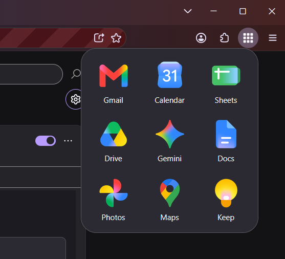
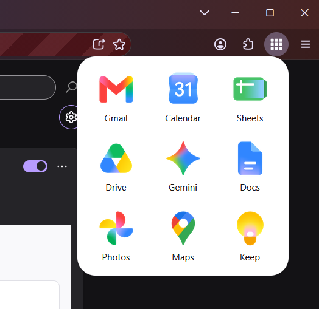

<p align="center"></p>

# WaffleLauncher

A privacy-first Firefox add-on that puts your favorite web apps (Google, Proton and more) one click away. Click the waffle button in the toolbar to get a grid of your apps, and click one to open it in a new tab.

- **Toolbar waffle button** that matches light and dark Firefox themes
- **3×3 or 4×4 grid** of the apps you choose (9 or 16 apps)
- **Drag or use the keyboard to reorder**, right in the popup
- **Settings** to pick which apps appear, one right-click away
- **Light, dark or automatic** look, matching Firefox by default
- **Background tabs:** Ctrl-click (Cmd-click on Mac) or middle-click to open several apps at once
- **Smart opening** (optional): reuse the current tab when it's a new or blank tab
- **Syncs** your choices between devices through Firefox Sync, if you use it

<p align="center">
  
  
  <br>
  <em>The popup in the dark and light looks</em>
</p>

## Background

WaffleLauncher started with someone else's good idea. I was a longtime user of [Google App Launcher](https://github.com/asolkar/ffx-addon-gglappbtn) by Mahesh Asolkar, a simple toolbar button that put my Google apps one click away. It did exactly what I needed, and I'm grateful he built it and shared it with everyone.

After a while the original stopped receiving updates, and it needed some work to keep up with modern Firefox. I forked it and tried to send my fixes back to the original project so everyone could benefit, but they never made it in. That's completely understandable for a free project its author has moved on from.

Rather than keep patching code that wasn't mine, I decided to start over. WaffleLauncher is a ground-up rewrite that shares none of the original code. It keeps the same simple idea and adds what I wanted: privacy first, apps beyond Google, dark mode and keyboard support. Thank you, Mahesh, for the inspiration.

### About the use of AI

I want to be upfront: this add-on was built with heavy help from AI. I know that's a turn-off for many people, and I respect that. For me, it made it possible to build something that fits exactly what I needed. Every change was reviewed and tested before it was committed, and the add-on's privacy rules, tests and checks are all in this repository for anyone to inspect.

## Privacy

WaffleLauncher collects no data. None.

- **No data collection, analytics or telemetry.** The add-on declares to Firefox that it collects no data.
- **Three permissions:**
  - `storage`, to remember your choices.
  - `activeTab`, used only by the optional **Smart** setting. When you click an app with Smart turned on, WaffleLauncher checks the address of the tab you're on, once, to see whether it's a new or blank tab. That address is never stored or sent anywhere. `activeTab` only covers the tab you're on, and only while you're using the popup; it never gives access to your other tabs or to any page's content.
  - `menus`, used only to add **WaffleLauncher settings** to the toolbar button's right-click menu. It gives no access to your tabs, pages or data.
- **The only things stored are your chosen apps (in order), your theme choice, and whether Smart opening is on.** Defaults (Automatic theme, New tab) store nothing. If you use Firefox Sync, these sync between your devices like your other Firefox settings. Nothing about your browsing, clicks or usage is stored.
- **No network requests.** Every icon and script is bundled with the add-on, and its pages run under a strict content security policy that blocks loading anything from the internet.
- **No access to page content.** WaffleLauncher can't read or change any page you visit.
- **Plain links.** Apps open at their normal addresses, with no tracking or referral codes added.

## Install

Get [WaffleLauncher on Firefox Add-ons](https://addons.mozilla.org/en-US/firefox/addon/wafflelauncher/). Requires Firefox 140 or later (Firefox for Android 142 or later).

## Using it

**Popup.** Click the waffle button in the toolbar.

- Click an app to open it in a new tab (or, with **Smart** on, in the current tab if it's a new or blank tab). You can also press Tab to move between apps and Enter to open one.
- **Ctrl-click** (Cmd-click on Mac), **middle-click**, or **Ctrl+Enter** opens an app in a background tab and keeps the popup open, so you can open several in a row.
- Hover over an app to see its full name.
- Drag an app onto another to move it there. The new order saves right away.
- **With the keyboard:** use the arrow keys (and Home/End) to move between apps, and **Ctrl + arrow keys** to move the selected app one spot. On a Mac, **Option + arrow keys** works too.

**Settings.** Right-click the waffle button and choose **WaffleLauncher settings**, or open `about:addons`, click WaffleLauncher, then the **Preferences** tab. The settings page also opens once, right after you first install WaffleLauncher.

- Check an app to add it to the end of your grid; uncheck it to remove it. Changes save right away.
- Your grid holds up to 9 apps, or 16 with the 4×4 grid size. When it's full, uncheck one to make room for another. The last app can't be removed, so the grid is never empty.
- Drag apps in the **Your grid** preview to reorder them, or use the same keyboard shortcuts as in the popup.
- Under **Opening apps**, choose **New tab** (the default) or **Smart** (use the current tab when it's a new or blank tab, otherwise a new tab).
- Under **Appearance**, choose a theme: **Automatic** (match Firefox), **Light** or **Dark**. The popup and options page switch right away.
- Also under **Appearance**, choose the grid size: **3×3** (the default) or **4×4**. Switching back to 3×3 removes apps 10 to 16; an **Undo** button brings them back.
- **Restore defaults** brings back the original 9 apps, New tab, the Automatic theme and the 3×3 grid.

## Supported apps

<!-- apps:start (generated by `npm run readme-apps`; edit src/apps.js instead) -->
### Google

**Everyday (46):** Google Account, Google Arts & Culture, Blogger, Google Calendar, Google Chat, Chrome Remote Desktop, Google Classroom, Google Contacts, Google Docs, Google Drive, Google Earth, Google Finance, Find Hub, Google Flights, Google Fonts, Google Forms, Google Gemini, Gemini Notebook, Gmail, Google Groups, Google Home, Google Keep, Google Maps, Google Meet, Google Messages, Google News, Google One, Google Photos, Google Play, Google Play Books, Google Scholar, Google Search, Google Sheets, Google Shopping, Google Sites, Google Slides, Google Tasks, Google Translate, Google Trends, Google Vids, Google Voice, Google Wallet, YouTube, YouTube Kids, YouTube Music, YouTube TV.

**Business and developer (8):** Google Admin console, Google Ads, Google AI Studio, Google Analytics, Google Business Profile, Google Cloud console, Google Labs, Google Search Console.

### Proton

Lumo, Proton Account, Proton Calendar, Proton Docs, Proton Drive, Proton Mail, Proton Meet, Proton Pass, Proton Sheets, Proton Wallet, SimpleLogin, Standard Notes.

### Other

Apple Maps, ChatGPT, Claude, Duck.ai, DuckDuckGo.
<!-- apps:end -->

The default grid is Gmail, Calendar, Sheets, Drive, Gemini, Docs, Photos, Maps and Keep.

## Adding an app or a service

Every app lives in one file, [`src/apps.js`](src/apps.js).

**To add an app:**

1. Put its icon in `src/icons/<service>/`, for example `src/icons/google/drive.svg`. Both SVG and PNG work; PNGs should be at least 128×128. SVGs must be self-contained, with no links to outside files or fonts.
2. Add an entry to `APPS` in `src/apps.js`:
   ```js
   { id: "google-drive", service: "google", shortName: "Drive", name: "Google Drive", url: "https://drive.google.com/", icon: "icons/google/drive.svg" },
   ```
   - `id` is `<service>-<app>`, lowercase with dashes. **Never rename an ID once released**: it's what users' saved settings refer to.
   - `shortName` shows on the tile (about 10 characters fit). `name` is the full name, shown in tooltips and on the options page.
   - `url` is a plain `https://` address with no tracking parameters.
3. Run `npm run readme-apps` to update the list in this README, then `npm run check` to catch mistakes.

**To add a service** (for example Proton): add it to `SERVICES` in `src/apps.js` (optionally with `groups`, like Google's Everyday and Business and developer), create `src/icons/<service>/`, then add its apps as above, each with a `group` if the service has groups. The options page and this README show each service and group as its own section, alphabetized; no other code changes are needed.

## Development

You need [Node.js](https://nodejs.org/) (developed with v24) and Firefox 140 or later.

```bash
npm install
```

| Command | What it does |
|---|---|
| `npm start` | Opens a test Firefox with the add-on loaded; reloads when files change |
| `npm test` | Runs the unit tests |
| `npm run check` | Checks the app list for mistakes |
| `npm run check -- --release` | Same, and also fails if any app still uses the placeholder icon |
| `npm run lint` | Runs Mozilla's add-on checks (the same ones used for AMO review) |
| `npm run build` | Packages the add-on into `web-ext-artifacts/` for upload |

Only the `src/` folder ships in the add-on:

```
src/
├── manifest.json
├── apps.js          app list: every app, plus the defaults
├── settings.js      loads and saves your settings (the only code that uses storage)
├── theme.js         applies the light, dark or automatic theme to a page
├── open.js          rules for how a click opens an app (new, current or background tab)
├── background.js    the right-click settings item, and opening settings after install
├── grid/            tiles, drag and keyboard reordering, shared by the popup and options page
├── popup/           the toolbar popup
├── options/         the options page
└── icons/           toolbar icons, and one folder of app icons per service
scripts/             dev-only: the app list check
tests/               dev-only: unit tests
```

## Support

If WaffleLauncher is useful to you, you can [buy me a coffee on Ko-fi](https://ko-fi.com/frye_jeff).

## Trademarks

App names and logos belong to their owners:

- Google, Gmail, YouTube and related product names and logos are trademarks of Google LLC.
- Proton, Proton Mail, Lumo, Standard Notes, SimpleLogin and related product names and logos are trademarks of Proton AG.
- Claude is a trademark of Anthropic, PBC.
- ChatGPT is a trademark of OpenAI.
- Apple and Apple Maps are trademarks of Apple Inc.
- DuckDuckGo and Duck.ai are trademarks of DuckDuckGo, Inc.

WaffleLauncher is an independent project and is not affiliated with or endorsed by any of these companies or the services it links to.

## License

[Mozilla Public License 2.0](LICENSE).
